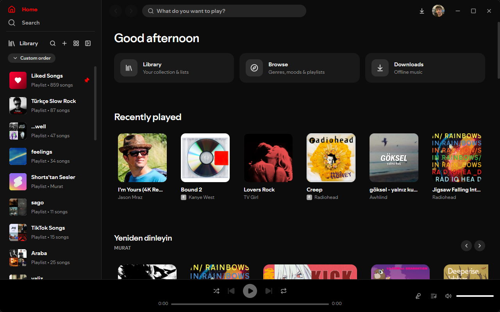
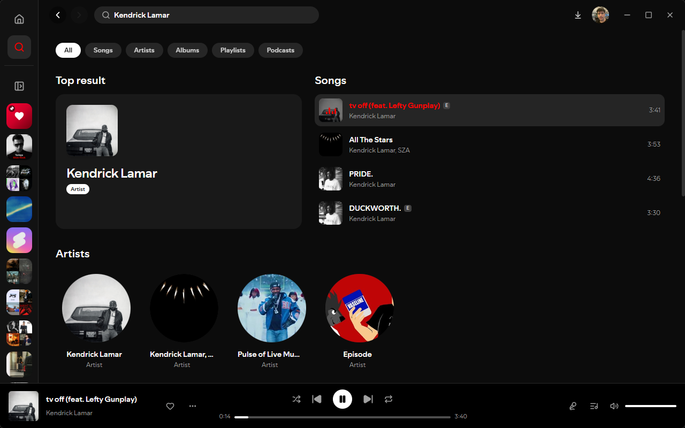
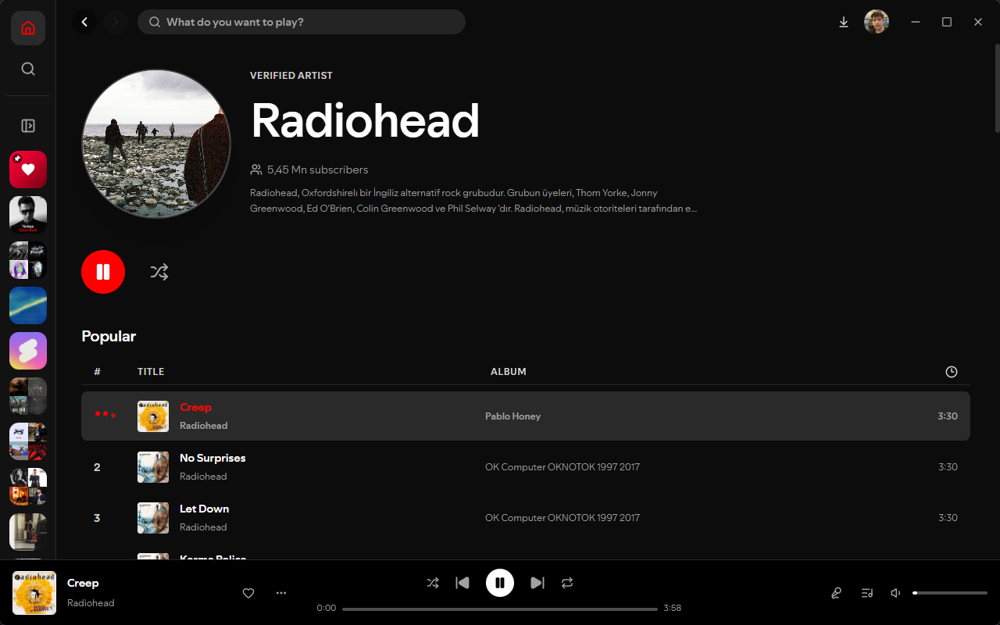
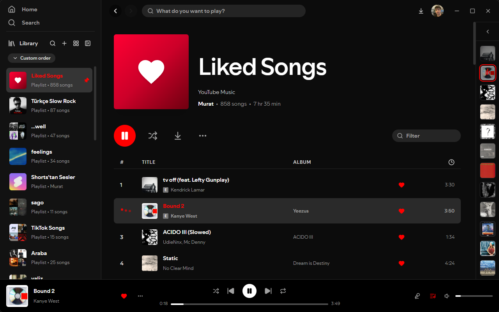
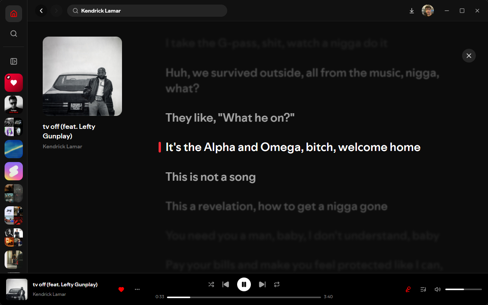

<p align="center">
  
</p>

<h1 align="center">Tubify</h1>

<p align="center">
  A fast, native-feeling desktop client for YouTube Music.<br />
  Built with Tauri, React, and TypeScript for <b>Windows, macOS and Linux</b>.
</p>

<p align="center">
  <a href="https://github.com/muratbas/tubify/releases/latest"></a>
  <a href="https://github.com/muratbas/tubify/blob/main/LICENSE"></a>
  <a href="https://github.com/muratbas/tubify/stargazers"></a>
</p>

<p align="center">
  <picture>
    
  </picture>
</p>

> [!IMPORTANT]
> Tubify is an independent, unofficial project. It is not affiliated with, authorized by,
> sponsored by, or endorsed by YouTube or Google.

<br />

## About

Tubify brings YouTube Music to the desktop as a standalone, native-feeling application. Built with Tauri and Rust, it is designed to be lightweight and fast, completely bypassing the heavy resource usage of standard browser tabs or Chromium-based wrappers.

If you find it useful, **starring the repo** genuinely helps.

<br />

## Screenshots

<table>
  <tr>
    <td width="50%"><b>Instant Library & Smart Caching</b></td>
    <td width="50%"><b>Artist & Album Pages</b></td>
  </tr>
  <tr>
    <td></td>
    <td></td>
  </tr>
  <tr>
    <td><sub>Playlists load instantly via stale-while-revalidate background caching.</sub></td>
    <td><sub>Detailed views including track play counts natively parsed from YouTube.</sub></td>
  </tr>
</table>

<table>
  <tr>
    <td width="50%"><b>Queue & Playback</b></td>
    <td width="50%"><b>Entity-Based Search History</b></td>
  </tr>
  <tr>
    <td></td>
    <td></td>
  </tr>
  <tr>
    <td><sub>Seamless track transitions with custom audio quality selectors.</sub></td>
    <td><sub>Recent searches are saved as rich clickable cards (Songs, Artists, Albums).</sub></td>
  </tr>
</table>

<p align="center">
  
  <br />
  <sub>Lyrics</sub>
</p>

<br />

## Features

| Feature                    | Description                                                                                                                                                                     |
| -------------------------- | ------------------------------------------------------------------------------------------------------------------------------------------------------------------------------- |
| **Audio Quality Selector** | Choose your streaming quality up to 256kbps AAC (ITAG 141) for Premium accounts, or save data with 50kbps Opus.                                                                 |
| **Offline Music**          | Download a song and listen it whenever you want.                                                                                                                                |
| **Discord Rich Presence**  | Automatically share what you are listening to on your Discord profile, complete with album art and live time tracking.                                                          |
| **Account Syncing**        | Your search queries and playback history ping back to your YouTube account, syncing instantly with your official mobile app.                                                    |
| **Smart Pre-fetching**     | Playlists open with 0ms delay thanks to hover pre-fetching and a stale-while-revalidate local JSON cache.                                                                       |
| **Modern UI**              | Clean settings panel, entity-card search history, system theme sync, and play counts displayed directly in album views.                                                         |
| **Local Auto-Updates**     | In-place, cryptographically signed updates powered by Tauri Updater. No manual re-downloads required.                                                                           |
| **Lightweight Core**       | Runs on the system's native WebView (WebView2/WebKit) rather than bundling Chromium, keeping memory usage incredibly low.                                                       |
| **Recommandations**        | Personalised suggestions on your playlist.                                                                                                                                      |
| **Browse**                 | Explore, charts, moods and genres, and podcasts, with mood chips you can drill into.                                                                                            |
| **Synced lyrics**          | Line-by-line lyrics that follow the song, unlike the official web client. Click a line to jump to it, nudge the timing if a match is off, and pick which source is tried first. |

<br />

## Download

Grab the newest installer from the **[latest release](https://github.com/muratbas/tubify/releases/latest)** for Windows, macOS or Linux.

<br />

## Platform support

- **Windows** — Primary target; securely signed and tested (WebView2).
- **macOS** — Supported; runs on WebKit (WKWebView).
- **Linux** — Supported; runs on WebKitGTK and GStreamer.

## For developers

### Prerequisites

Node.js LTS and npm
[Rust and Cargo](https://rustup.rs/)
C++ build tools (MSVC on Windows)
Microsoft Edge WebView2 Runtime (Windows)

The Tauri CLI ships in the project's dev dependencies — no global install needed.

### Install, run, build

```bash

npm install

npm run tauri dev

npm run tauri build

```

## Legal

**Tubify** is a streaming client and **does not provide raw media ripping functionalities.** Audio is securely
cached locally in a proprietary .bin format exclusively for offline playback within the app itself.

Tubify interacts with YouTube and YouTube Music. Access to those services remains governed by their own terms,
policies, availability, and regional restrictions. Tubify does not host or claim ownership of music, videos, artwork,
metadata, or any other content supplied by third parties. Rights in that content remain with their respective owners.

YouTube and YouTube Music are trademarks of Google LLC. All other trademarks are the property of their respective owners.

[YouTube Terms of Service](https://www.youtube.com/static?template=terms)
[YouTube API Services Terms of Service](https://developers.google.com/youtube/terms/api-services-terms-of-service)
[YouTube API Services Developer Policies](https://developers.google.com/youtube/terms/developer-policies)
